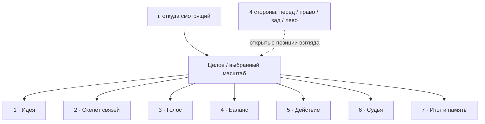

# Карта 4i7 — анатомия исследуемой модели

> **Статус: исследование.** Эта карта связывает действующее описание в README, первоначальную [issue #1](https://github.com/i4w7w4a/4i7_psys/issues/1) и отдельные части. Связи и семантика четырёх сторон — рабочие гипотезы, а не окончательно утверждённый канон.

4i7 разделяет **наблюдателя (i)**, **семь областей понимания (7)**, **четыре стороны взгляда (4)**, **маршруты внимания**, **отношения между частями** и **масштабы**. Цель — не механическое заполнение ячеек, а обнаружение существенных связей и возврат проверенного опыта в следующее решение.

## Начать с наглядных карточек

**[Семь карточек с четырьмя сторонами](07-seven-cards.md)** — компактный SVG-обзор, вертикальные карточки для чтения с телефона, авторские опоры и видимые пробелы. Новые понятия из #4–6 показаны отдельно от неутверждённых назначений сторон. Это дополняет существующий каркас, не меняя его идентификаторы и фундамент.

## Простая карта

Стрелки от целого к частям обозначают **области рассмотрения**, не неизбежный конвейер и не семь отдельных агентов.

## Семь столпов

| № | Авторский образ | Рабочее объяснение | Подробности |
|---|---|---|---|
| 1 | Идея | Замысел / зачем | [01](pillars/01-idea.md) |
| 2 | Скелет взаимосвязей | Структура / от чего зависит | [02](pillars/02-structure.md) |
| 3 | Горло, голос | Выражение / как передать смысл | [03](pillars/03-voice.md) |
| 4 | Баланс | Согласование / какая мера уместна | [04](pillars/04-balance.md) |
| 5 | Действие, написание кода | Воплощение / что изменилось | [05](pillars/05-action.md) |
| 6 | Судья, ревью | Проверка / чему доверять | [06](pillars/06-judge.md) |
| 7 | Итоги, документация, следующий шаг | Усвоение / что наследуется | [07](pillars/07-memory.md) |

## Остальные слои

- [i — наблюдатель и оркестратор](01-observer.md): почему это не восьмой столп и какие у него границы.
- [Четыре направления и 28 позиций](02-directions.md): пока **без закреплённых значений**.
- [Связи и спирали](03-relations.md): маршрут, пары, возвраты и масштабы.
- [Перенос на существующую OS](04-transfer.md): аудит и безопасное наложение модели.
- [Память, векторы и происхождение знания](05-memory.md): предпосылки, но **не готовый vector store**.
- [Живое развитие модели](06-evolution.md): цикл от нового источника до пересмотра определений.
- [Пакет контекста для агента](../scripts/context_pack.py): выборочная загрузка столпа и знаний с учётом статуса.
- [Память 4i7](../knowledge/README.md) и [индекс](../knowledge/index.json): происхождение, статусы, журнал решений.
- [Машиночитаемая карта](../model/4i7.json): стабильные идентификаторы и исследовательские статусы.
- [Шаблон столпа](templates/pillar.md) и [шаблон стороны](templates/side.md): как развивать систему без потери связности.

## Не путать

1. **Семь** — виды понимания, а не обязательные последовательные агенты.
2. **Четыре** — позиции взгляда, а не подтверждённые значения/роли.
3. **Спираль** — возможная последовательность смены позиций, не полный граф всех зависимостей.
4. **i** — точка удержания рамки, не мистическое всезнание и не автоматическое право менять чужой проект.
5. **Фрактальность** — повторение вопросов на выбранном масштабе, не бесконечная рекурсия.

Для начала исследовательской работы достаточно выбрать целое, смысловой вопрос и одну-две связи. Для внедрения — сначала проверить, что в реальном проекте уже существует.
