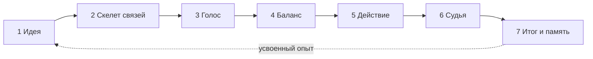
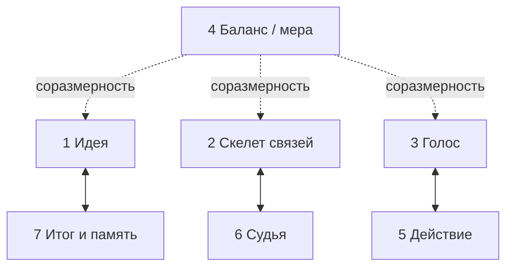

# Связи, пары, спирали и фрактальные масштабы

В 4i7 важно не только содержимое столпа, но и **какое новое понимание переносится через связь**. Сохраняй разные типы связей раздельно.

## 1. Проход от замысла к опыту

Это **удобный способ чтения**, а не обязательный pipeline. При выявлении противоречия Пятый вправе возвращаться к Третьему, Шестой — ко Второму и т. д.

## 2. Поперечные пары — предложенная композиция

- **1 ↔ 7:** ожидание и усвоенный опыт.
- **2 ↔ 6:** представление об устройстве и подтверждение.
- **3 ↔ 5:** переданное обещание и фактическое воплощение.
- **4:** согласование этих отношений в конкретной ситуации; не подмена i.

Эти пары предложены к исследованию. Они не заменяют прямые зависимости.

## 3. Спираль — маршрут внимания

Две иллюстрации описаны в [направлениях](02-directions.md). При четырёх стартовых направлениях один порядок вращения способен посетить все 28 адресуемых позиций за четыре прохода. Обратный порядок даёт другую очередность, **не 28 новых позиций**. Само посещение не гарантирует проверку всех связей и не доказывает улучшение качества.

## 4. Масштаб

На уровнях «проект → подсистема → задача» можно задать те же семь вопросов. Дочерняя ветвь **наследует цель и ограничения родительской**. Углубление не обязательно для каждой мелочи. Переход к более крупному масштабу обязателен при конфликте локального и глобального решений.

## 5. Протокол перехода

Передавать минимум: отправитель и адресат, вопрос, наблюдение, статус (факт/гипотеза/предложение), источник или версия контекста, ограничения, требуемая проверка, время актуальности, результат и причина возврата. В модели отношения представлены явно и имеют статус hypothesis.

## 6. Что проверить экспериментально

Сравнить обычный агентный процесс, тот же процесс с хорошей документацией и процесс со спиралями на сопоставимых задачах. Замерить пропущенные требования, количество исправлений, качество доказательств, время и вычислительные затраты. Пока преимущество спиралей не подтверждено.
