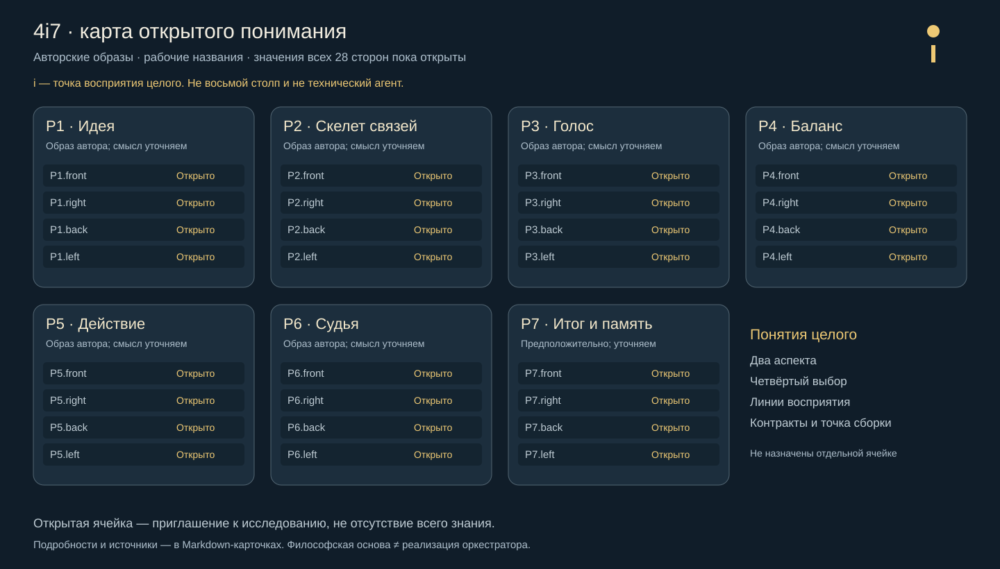

# 4i7 · семь карточек понимания

> **Рабочая философская карта, не окончательный канон.** Срез: 13 ноября 2026 года. Образы столпов из [исходной записи автора #1](https://github.com/i4w7w4a/4i7_psys/issues/1) ещё уточняются. У каждой карточки четыре стороны, но значения **всех 28 сторон пока открыты**. Пробелы показаны честно. Рядом даны четыре **кандидата ракурса** для каждого столпа, чтобы было что обсуждать и менять, но они не заняли пространственные адреса автоматически.

На компьютере обзор располагается сеткой 4 + 3. На узком экране увеличьте SVG либо читайте вертикальные карточки ниже: семь подробных карточек невозможно одновременно сделать крупными на телефоне. [Открыть SVG отдельно](assets/seven-cards.svg).

**Легенда:** «Автор» — сохранённый образ, не доказанная теория; «Рабочее прочтение» — интерпретация; «Открыто» — значение не установлено. Авторское согласие и эмпирическая проверка — разные основания.

## Новое раскрытие автора: идея, суть и i

В голосовом разговоре 13 ноября 2026 года автор сказал:

> «В идее главное это её суть. А суть это отражение того, чем она является. А чем она является это то, что приобретает смысл для каждого, кто с ней сталкивается».

Автор описывает **i как мета-идею**: точка символа — начало и смотрящий, палочка — движение и семь столпов. Суть одна «для нас», но раскрывается по-разному разным людям и применениям; оркестратор — одно из применений общей основы. Это запись нового авторского раскрытия, не утверждение о сознании ИИ и не замена всех прежних определений. Отношение этих формулировок к присутствию и точке сборки остаётся предметом разговора.

**Источник:** текущий голосовой разговор автора с dot, 13.11.2026; первичная фиксация в этом изменении PR. Не приписывается задним числом issue #1 или #7. Вопросы-ракурсы ниже — предложения редактора для продолжения, не дословные слова автора.

## Как пользоваться

1. Выберите столп по его образу, прочитайте опору автора и рабочее прочтение отдельно.
2. Откройте подробную карточку. Если выбрана сторона, используйте её существующий адрес: например, `P7.right`.
3. Запишите конкретную формулировку автора и её источник. Предложение агента пометьте предложением, а не заполнением принятого смысла.
4. Сохраните вопрос, переход и новый смысл отдельно от значения ячейки. Одно положение может касаться нескольких мест или пока быть не размещено.

Названия `front/right/back/left` сохранены из [машинной модели](../model/4i7.json); мы не заменяем их S1–S4 и не утверждаем соответствие числовых сторон автора этим направлениям без решения. Пример «седьмой столп, вторая сторона» **не задаёт её содержание**.

## P1 · Идея

**Автор:** Идеи, место возникновения и обсуждения замысла.

**Рабочее прочтение:** Замысел. Вопрос для обсуждения: Что действительно хотим изменить и зачем?

| Сторона / существующий адрес | Что известно о её смысле |
|---|---|
| Спереди · `P1.front` | **Открыто** · `unassigned` |
| Справа · `P1.right` | **Открыто** · `unassigned` |
| Сзади · `P1.back` | **Открыто** · `unassigned` |
| Слева · `P1.left` | **Открыто** · `unassigned` |

### Четыре кандидата ракурса — предложение для обсуждения

Это **не назначение** пространственным сторонам `front/right/back/left`. Каждый вопрос можно менять или отвергать; порядок перечисления не определяет геометрию. Основа: [вариант общей грамматики из #7](https://github.com/i4w7w4a/4i7_psys/issues/7), адаптирован к новому авторскому акценту на сути идеи.

- **Предложение:** Что составляет суть идеи?
- **Предложение:** Как смысл раскрывается разным людям?
- **Предложение:** Что нельзя потерять при выражении сути?
- **Предложение:** Что меняется в понимании при новом раскрытии?

[Раскрыть карточку P1](pillars/01-idea.md) · [Источник #1](https://github.com/i4w7w4a/4i7_psys/issues/1)

## P2 · Скелет связей

**Автор:** Скелет взаимосвязей; устройство целого, что от чего зависит.

**Рабочее прочтение:** Структура. Вопрос для обсуждения: Из чего состоит целое, что от чего зависит?

| Сторона / существующий адрес | Что известно о её смысле |
|---|---|
| Спереди · `P2.front` | **Открыто** · `unassigned` |
| Справа · `P2.right` | **Открыто** · `unassigned` |
| Сзади · `P2.back` | **Открыто** · `unassigned` |
| Слева · `P2.left` | **Открыто** · `unassigned` |

### Четыре кандидата ракурса — предложение для обсуждения

Это **не назначение** пространственным сторонам `front/right/back/left`. Каждый вопрос можно менять или отвергать; порядок перечисления не определяет геометрию. Основа: [вариант общей грамматики из #7](https://github.com/i4w7w4a/4i7_psys/issues/7).

- **Предложение:** Какие части и различия видим?
- **Предложение:** Что от чего зависит?
- **Предложение:** Где границы карты и чего она не описывает?
- **Предложение:** Какие связи меняются при новом понимании?

[Раскрыть карточку P2](pillars/02-structure.md) · [Источник #1](https://github.com/i4w7w4a/4i7_psys/issues/1)

## P3 · Голос

**Автор:** Горло, голос, то, что говорит и выражает.

**Рабочее прочтение:** Выражение. Вопрос для обсуждения: Как сделать смысл выразимым и передаваемым без искажения?

| Сторона / существующий адрес | Что известно о её смысле |
|---|---|
| Спереди · `P3.front` | **Открыто** · `unassigned` |
| Справа · `P3.right` | **Открыто** · `unassigned` |
| Сзади · `P3.back` | **Открыто** · `unassigned` |
| Слева · `P3.left` | **Открыто** · `unassigned` |

### Четыре кандидата ракурса — предложение для обсуждения

Это **не назначение** пространственным сторонам `front/right/back/left`. Каждый вопрос можно менять или отвергать; порядок перечисления не определяет геометрию. Основа: [вариант общей грамматики из #7](https://github.com/i4w7w4a/4i7_psys/issues/7).

- **Предложение:** Как сейчас сформулирован смысл?
- **Предложение:** Кто должен его понять и с чем связать?
- **Предложение:** Где неоднозначность или навязанный словарь?
- **Предложение:** Как переформулировка изменит понимание?

[Раскрыть карточку P3](pillars/03-voice.md) · [Источник #1](https://github.com/i4w7w4a/4i7_psys/issues/1)

## P4 · Баланс

**Автор:** Баланс.

**Рабочее прочтение:** Согласование / мера. Вопрос для обсуждения: Какое действие соразмерно ценности, связности, ресурсам и риску?

| Сторона / существующий адрес | Что известно о её смысле |
|---|---|
| Спереди · `P4.front` | **Открыто** · `unassigned` |
| Справа · `P4.right` | **Открыто** · `unassigned` |
| Сзади · `P4.back` | **Открыто** · `unassigned` |
| Слева · `P4.left` | **Открыто** · `unassigned` |

### Четыре кандидата ракурса — предложение для обсуждения

Это **не назначение** пространственным сторонам `front/right/back/left`. Каждый вопрос можно менять или отвергать; порядок перечисления не определяет геометрию. Основа: [вариант общей грамматики из #7](https://github.com/i4w7w4a/4i7_psys/issues/7).

- **Предложение:** Что требуется согласовать?
- **Предложение:** Какие ценности и требования влияют друг на друга?
- **Предложение:** Какие ограничения нельзя игнорировать?
- **Предложение:** Что приобретается и теряется при выборе?

[Раскрыть карточку P4](pillars/04-balance.md) · [Источник #1](https://github.com/i4w7w4a/4i7_psys/issues/1)

## P5 · Действие

**Автор:** Действие; написание кода — только пример из программирования.

**Рабочее прочтение:** Воплощение. Вопрос для обсуждения: Что на самом деле изменено или испытано?

| Сторона / существующий адрес | Что известно о её смысле |
|---|---|
| Спереди · `P5.front` | **Открыто** · `unassigned` |
| Справа · `P5.right` | **Открыто** · `unassigned` |
| Сзади · `P5.back` | **Открыто** · `unassigned` |
| Слева · `P5.left` | **Открыто** · `unassigned` |

### Четыре кандидата ракурса — предложение для обсуждения

Это **не назначение** пространственным сторонам `front/right/back/left`. Каждый вопрос можно менять или отвергать; порядок перечисления не определяет геометрию. Основа: [вариант общей грамматики из #7](https://github.com/i4w7w4a/4i7_psys/issues/7).

- **Предложение:** Что фактически делаем или испытываем?
- **Предложение:** Какие условия и участники нужны?
- **Предложение:** Что допустимо и обратимо?
- **Предложение:** Какой результат и новые вопросы возникли?

[Раскрыть карточку P5](pillars/05-action.md) · [Источник #1](https://github.com/i4w7w4a/4i7_psys/issues/1)

## P6 · Судья

**Автор:** Судья, ревью, проверки; техническая проверка — одно из применений.

**Рабочее прочтение:** Проверка / различение. Вопрос для обсуждения: Что подтверждено, чем и при каких условиях?

| Сторона / существующий адрес | Что известно о её смысле |
|---|---|
| Спереди · `P6.front` | **Открыто** · `unassigned` |
| Справа · `P6.right` | **Открыто** · `unassigned` |
| Сзади · `P6.back` | **Открыто** · `unassigned` |
| Слева · `P6.left` | **Открыто** · `unassigned` |

### Четыре кандидата ракурса — предложение для обсуждения

Это **не назначение** пространственным сторонам `front/right/back/left`. Каждый вопрос можно менять или отвергать; порядок перечисления не определяет геометрию. Основа: [вариант общей грамматики из #7](https://github.com/i4w7w4a/4i7_psys/issues/7).

- **Предложение:** Что именно проверяем?
- **Предложение:** Какие основания и альтернативы есть?
- **Предложение:** Чего проверка не устанавливает?
- **Предложение:** Что надо пересмотреть по результату?

[Раскрыть карточку P6](pillars/06-judge.md) · [Источник #1](https://github.com/i4w7w4a/4i7_psys/issues/1)

## P7 · Итог и память (предварительно)

**Автор:** Предположительно итоги, документация и подготовка следующего шага. Определение особенно предварительное.

**Рабочее прочтение:** Усвоение. Вопрос для обсуждения: Что нужно сохранить и как опыт изменит следующий замысел?

| Сторона / существующий адрес | Что известно о её смысле |
|---|---|
| Спереди · `P7.front` | **Открыто** · `unassigned` |
| Справа · `P7.right` | **Открыто** · `unassigned` |
| Сзади · `P7.back` | **Открыто** · `unassigned` |
| Слева · `P7.left` | **Открыто** · `unassigned` |

### Четыре кандидата ракурса — предложение для обсуждения

Это **не назначение** пространственным сторонам `front/right/back/left`. Каждый вопрос можно менять или отвергать; порядок перечисления не определяет геометрию. Основа: [вариант общей грамматики из #7](https://github.com/i4w7w4a/4i7_psys/issues/7).

- **Предложение:** Что переносим дальше как опыт?
- **Предложение:** С чем прежним это согласуется или конфликтует?
- **Предложение:** Каковы условия и границы применимости?
- **Предложение:** Как это изменит следующий замысел?

[Раскрыть карточку P7](pillars/07-memory.md) · [Источник #1](https://github.com/i4w7w4a/4i7_psys/issues/1)

## Понятия, которые связывают карту

Это не «восьмая карточка» и не принудительное распределение по сторонам.

| Авторская опора | Что остаётся открытым | Источник |
|---|---|---|
| **i:** присутствие, акт восприятия; «я, откуда смотрящий» | Отношение к различению и точке сборки | [#5](https://github.com/i4w7w4a/4i7_psys/issues/5) |
| **Двойственность:** два аспекта стороны | Значения пар и их связь с i; не обязательно добро/зло | [#4](https://github.com/i4w7w4a/4i7_psys/issues/4) |
| **Четвёртый выбор:** «Есть да, есть нет, есть воздержание и четвёртый выбор…» | Как не закрывать понимание преждевременно и при этом приходить к определению | [#5 и рассказ об опыте](https://github.com/i4w7w4a/4i7_psys/issues/5#issuecomment-6860649983) |
| **Линии восприятия:** путь, на котором возникает общий смысл | Что означает каждый переход и завершение пути | [#6](https://github.com/i4w7w4a/4i7_psys/issues/6) |
| **Контракт:** «якорь цепей смыслов»; договорённость воспринимать определённым образом | Отношение к отдельному умозаключению и всей цепочке | [Уточнение автора](https://github.com/i4w7w4a/4i7_psys/issues/6#issuecomment-6860929727) |
| **Точка сборки:** собирает контракты по пути линии | Как соотносится с i и P7; что происходит по ходу и в конце | [#6](https://github.com/i4w7w4a/4i7_psys/issues/6) |

Два аспекта здесь показаны **как исследуемая тема**, а не как уже добавленные 56 машинных адресов. В текущем JSON по-прежнему 28 адресов сторон. Четвёртый выбор не приравнивается к P4 или четвёртой стороне.

## Что наполнять следующим

- Уточнить смысл одного столпа или одной выбранной стороны на конкретном примере, сохранив источник и неизвестное.
- Рассмотреть предложения [#7](https://github.com/i4w7w4a/4i7_psys/issues/7) как варианты, не копировать их в открытые клетки автоматически.
- Проследить одну линию: исходный вопрос → выбранные позиции → новый общий смысл → кандидат контракта → открытые вопросы.
- После обсуждения отдельно решить, какое определение временно принять и при каких условиях пересмотреть.

**Философская основа первична для этой карты.** Будущий Linux-оркестратор, база памяти и управление компьютером — отдельная адаптация, не уже работающие возможности этой схемы. [Перенос](04-transfer.md) описывает будущую работу, а не заменяет основу.

## Проверяемость и происхождение

Обзор развивается в существующем [draft PR #2](https://github.com/i4w7w4a/4i7_psys/pull/2). SVG — точная схема числа карточек и незаполненных сторон, не генеративная иллюстрация. При обновлении модели нужно обновить обзор и SVG вместе. Полные исследования должны сохраняться отдельно от синтеза; эта карта **не является полным архивом ответов Pro**. Ссылки на обсуждения требуют доступа к приватному репозиторию.
