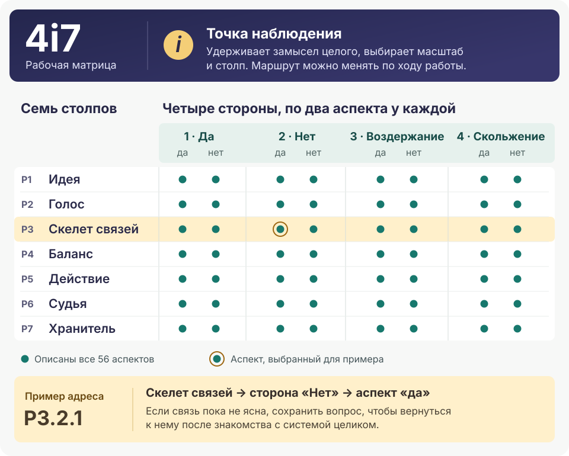

# Карта системы 4i7

В 4i7 целое можно рассматривать с разных сторон. **`i` обозначает точку наблюдения.** Из неё выбирают предмет, масштаб и направление взгляда. **Семь столпов** дают семь способов увидеть одно целое. У каждого столпа есть **четыре стороны**, а у каждой стороны — **два аспекта**. [О наблюдателе](https://github.com/i4w7w4a/4i7_psys/blob/cd08675d0e289765d27c231aaeba88399d650b62/docs/01-observer.md) · [Вся матрица](https://github.com/i4w7w4a/4i7_psys/blob/bb9c34dac403a208feb8c51787b69e5386ad58c9/docs/09-matrix.md)

[Семь столпов](#семь-столпов) · [Стороны и аспекты](#стороны-и-аспекты) · [Связи между столпами](#связи-между-столпами) · [Последняя редакция](#последняя-редакция) · [Каталог материалов](#каталог-материалов)

## Семь столпов

Номер столпа помогает найти его в матрице. Маршрут зависит от того, что заметил наблюдатель. Название в таблице ведёт прямо к четырём сторонам этого столпа в рабочей версии.

| Адрес | Столп | Что он позволяет увидеть |
| --- | --- | --- |
| P1 | [Идея](https://github.com/i4w7w4a/4i7_psys/blob/bb9c34dac403a208feb8c51787b69e5386ad58c9/docs/09-matrix.md#p1--идея-четыре-стороны) | Уловить исходный импульс, прояснить замысел и основания для сомнения. |
| P2 | [Голос](https://github.com/i4w7w4a/4i7_psys/blob/bb9c34dac403a208feb8c51787b69e5386ad58c9/docs/09-matrix.md#p2--голос-четыре-стороны) | Услышать намерение и понять, что выразить, кому адресовать слова и когда помолчать. |
| P3 | [Скелет связей](https://github.com/i4w7w4a/4i7_psys/blob/bb9c34dac403a208feb8c51787b69e5386ad58c9/docs/09-matrix.md#p3--скелет-четыре-стороны) | Увидеть, как связаны части. Если связь пока не видна, сохранить вопрос для возврата. |
| P4 | [Баланс](https://github.com/i4w7w4a/4i7_psys/blob/bb9c34dac403a208feb8c51787b69e5386ad58c9/docs/09-matrix.md#p4--баланс-четыре-стороны) | Соотнести нагрузку с ресурсами и запасом для роста, заметить перекос и выбрать меру вмешательства. |
| P5 | [Действие](https://github.com/i4w7w4a/4i7_psys/blob/bb9c34dac403a208feb8c51787b69e5386ad58c9/docs/09-matrix.md#p5--действие-четыре-стороны) | Осуществить задуманное, удержать границы действия и увидеть, что стоит продолжить или остановить. |
| P6 | [Судья](https://github.com/i4w7w4a/4i7_psys/blob/bb9c34dac403a208feb8c51787b69e5386ad58c9/docs/09-matrix.md#p6--судья-вердикт-отложенное-рассмотрение-и-воздержание) | Рассмотреть основания, вынести или отложить вердикт, пересмотреть его при появлении нового факта. |
| P7 | [Хранитель](https://github.com/i4w7w4a/4i7_psys/blob/bb9c34dac403a208feb8c51787b69e5386ad58c9/docs/09-matrix.md#p7--хранитель-четыре-стороны) | Решить, что сохранить в активной памяти, что оставить в истории и какой слабый сигнал ещё заслуживает внимания. |

## Стороны и аспекты

В рабочей матрице сторона 1 называется **Да**, 2 — **Нет**, 3 — **Воздержание**, 4 — **Скольжение**. Внутри каждой стороны есть два места — аспект «да» и аспект «нет». Их конкретный смысл раскрывается у своего столпа. Так получается 7 × 4 × 2 = **56 адресов**. [Сводная таблица матрицы](https://github.com/i4w7w4a/4i7_psys/blob/bb9c34dac403a208feb8c51787b69e5386ad58c9/docs/09-matrix.md#как-читать)

Например, `P3.2` — вторая сторона Скелета связей. Её первый аспект `P3.2.1` предлагает оставить якорь возврата к неясной связи. Второй, `P3.2.2`, описывает саму ситуацию, когда связь пока не найдена. [Оба аспекта P3](https://github.com/i4w7w4a/4i7_psys/issues/12#issuecomment-6878642283)

## Связи между столпами

**Линия восприятия** — путь внимания между столпами и их сторонами. Например, при разборе связей можно обнаружить, что два человека вкладывают разный смысл в одно слово. Тогда возникает повод обратиться к Голосу, услышать обоих и вернуться к Скелету связей с уточнением. Такая смена точки зрения позволяет части изменить понимание целого. [Линии восприятия и контракты](https://github.com/i4w7w4a/4i7_psys/issues/6)

В авторском словаре **контракт** удерживает вывод и цепочку смыслов, на которой он основан. **Суперконтракт** сохраняет взаимосвязи, через которые возникло более глубокое понимание. **Вес осознанности** описывает глубину и качество этих связей. Числовая мера для него остаётся открытой. [Живой словарь](https://github.com/i4w7w4a/4i7_psys/blob/5f106e8ba9057ed79aa65868d1aebf54890606d2/docs/glossary.md) · [Авторское обсуждение](https://github.com/i4w7w4a/4i7_psys/issues/12)

## Последняя редакция

19 ноября 2026 года автор принял рабочие формулировки для Воздержания Идеи и Скольжения Хранителя. Теперь **все 56 аспектов** имеют запись (`captured`). Матрица остаётся исследовательской (`under_review`), и к любому адресу можно вернуться, чтобы дополнить или пересмотреть его. [Решение автора](https://github.com/i4w7w4a/4i7_psys/issues/12#issuecomment-7019427154)

| Столп и сторона | Аспект «да» | Аспект «нет» |
| --- | --- | --- |
| P1/3 · Идея · Воздержание | **P1.3.1** Выслушать идею и вникнуть в её смысл, дать пониманию раскрыться. | **P1.3.2** Удержаться от преждевременного суждения, пока идея ещё раскрывается. |
| P7/4 · Хранитель · Скольжение | **P7.4.1** Возможность проскользить в любую из степеней системы. | **P7.4.2** Путь к главному Оракулу. В авторской формулировке — «оракул всегда имеет доступ». |

У Идеи авторская мысль о выслушивании получила принятую редакцию в двух аспектах. У Хранителя сохранены обе части авторского высказывания. Смысл «степеней» и границы доступа Оракула можно уточнить в дальнейшем. [История P1/3](https://github.com/i4w7w4a/4i7_psys/issues/12#issuecomment-6963072889) · [История P7/4](https://github.com/i4w7w4a/4i7_psys/issues/12#issuecomment-6962691863)

## Каталог материалов

| Раздел | Что в нём читать |
| --- | --- |
| Основа и её история | [Первоначальный текст](origins.md) · [Исходное обсуждение #1](https://github.com/i4w7w4a/4i7_psys/issues/1) · [Каркас #2](https://github.com/i4w7w4a/4i7_psys/pull/2) |
| Рабочая матрица | [Таблица и развёрнутые пояснения](https://github.com/i4w7w4a/4i7_psys/blob/bb9c34dac403a208feb8c51787b69e5386ad58c9/docs/09-matrix.md) · [Машиночитаемая версия](https://github.com/i4w7w4a/4i7_psys/blob/bb9c34dac403a208feb8c51787b69e5386ad58c9/model/research/matrix-20261114.json) · [История изменений #14](https://github.com/i4w7w4a/4i7_psys/pull/14) |
| Словарь | [20 понятий и их происхождение](https://github.com/i4w7w4a/4i7_psys/blob/5f106e8ba9057ed79aa65868d1aebf54890606d2/docs/glossary.md) · [Контракт и вес осознанности](https://github.com/i4w7w4a/4i7_psys/blob/5f106e8ba9057ed79aa65868d1aebf54890606d2/docs/research/2026-11-14-contract-and-awareness.md) |
| Визуальные материалы | [Атлас из 15 изображений](https://github.com/i4w7w4a/4i7_psys/blob/05d0064cafc2b75da054d9c94fd41d7e1168ff71/docs/research/visual-atlas-20261113/README.md) · отдельные серии [Идея](https://github.com/i4w7w4a/4i7_psys/tree/visuals/p1-five-20261114/docs/visuals/p1-20261114) и [Скелет связей](https://github.com/i4w7w4a/4i7_psys/tree/visuals/p3-skeleton-20261114/docs/visuals/p3-20261114) · [источники #9](https://github.com/i4w7w4a/4i7_psys/issues/9) · [стиль #16](https://github.com/i4w7w4a/4i7_psys/issues/16) |
| Исследования | [Передача контекста #3](https://github.com/i4w7w4a/4i7_psys/issues/3) · [двойственность #4](https://github.com/i4w7w4a/4i7_psys/issues/4) · [четвёртость #5](https://github.com/i4w7w4a/4i7_psys/issues/5) · [варианты карты #7](https://github.com/i4w7w4a/4i7_psys/issues/7) · исследования сторон [#10](https://github.com/i4w7w4a/4i7_psys/issues/10) и [#15](https://github.com/i4w7w4a/4i7_psys/issues/15) |
| Общий обзор 4i7 | [Исследование от 19 ноября #19](https://github.com/i4w7w4a/4i7_psys/issues/19). Полный текст разбирает архитектуру и сравнивает подходы на материале первоначальной версии. |
| Инструмент для агента | [Как устроен пакет контекста](https://github.com/i4w7w4a/4i7_psys/blob/bbca7d847386cdc03714b116b1c5a362058e38a2/docs/10-agent-runtime.md) · [Сборка #17](https://github.com/i4w7w4a/4i7_psys/pull/17) · [Замысел оркестратора #11](https://github.com/i4w7w4a/4i7_psys/issues/11) |

**Как читать ранние материалы.** В первой редакции P2 обозначал Скелет связей, P3 — Голос, P7 назывался «Итог и память». В рабочей матрице P2 — Голос, P3 — Скелет связей, P7 — Хранитель. Пространственные направления первоначального текста и стороны рабочей матрицы пока не сопоставлены. [История нумерации](https://github.com/i4w7w4a/4i7_psys/blob/bb9c34dac403a208feb8c51787b69e5386ad58c9/docs/research/2026-11-14-pillar-numbering.md) · [Первоначальное описание](origins.md)

В GitHub материалы можно просматривать по разделам. Связи между черновиками показаны на отдельной схеме. [Каталог в GitHub Projects для участников](https://github.com/users/i4w7w4a/projects/4/views/1) · [Схема материалов и веток](assets/work-map.svg)
