# Визуальный атлас 4i7

Исследовательские визуальные гипотезы, **не утверждённый канон**. 15 уникальных PNG, 10 основных направлений и 5 вариаций. Не используются как доказательство модели или точная математическая схема.

## Для нового агента

Сначала прочитайте [исходную основу](https://github.com/i4w7w4a/4i7_psys/issues/1), [двойственность](https://github.com/i4w7w4a/4i7_psys/issues/4), [четвёртый выбор](https://github.com/i4w7w4a/4i7_psys/issues/5), [матрицу и контракты](https://github.com/i4w7w4a/4i7_psys/issues/6) и [рабочие альтернативы](https://github.com/i4w7w4a/4i7_psys/issues/7). Затем смотрите изображения ниже и ограничения. Не принимайте размещение, цвет, высоту и линии на картинках за определения сторон или установленную топологию. A/B не означает автоматически добро/зло.

## Источники

- [Чат серии A с промптами](https://chatgpt.com/g/g-p-6897f0433bcc8191bee2a9f0b75b59db-4i7/c/6af75278-2188-83eb-8d55-83387e1f01cc)
- [Чат серии B с промптами](https://chatgpt.com/g/g-p-6897f0433bcc8191bee2a9f0b75b59db-4i7/c/6af75297-5ae4-83ed-8376-b136d913acca)

Чаты требуют отдельного доступа ChatGPT, однако изображения хранятся здесь независимо от них. Для чтения изображений достаточно доступа к приватному репозиторию и этой ветке. Это не делает чаты или репозиторий публичными.

## Авторское и предложенное

i — образ точки восприятия; 7 столпов, 4 стороны, двойственные аспекты; линии восприятия — пути внимания; контракт — якорь цепей смыслов, связанный с цепочкой логических умозаключений; точка сборки собирает контракты по пути. Значения сторон и строгая математическая модель остаются исследуемыми. Визуальные метафоры ниже предложены ИИ, не утверждены автором как фундамент.

## Галерея

### A1.png: Вертикальная карта

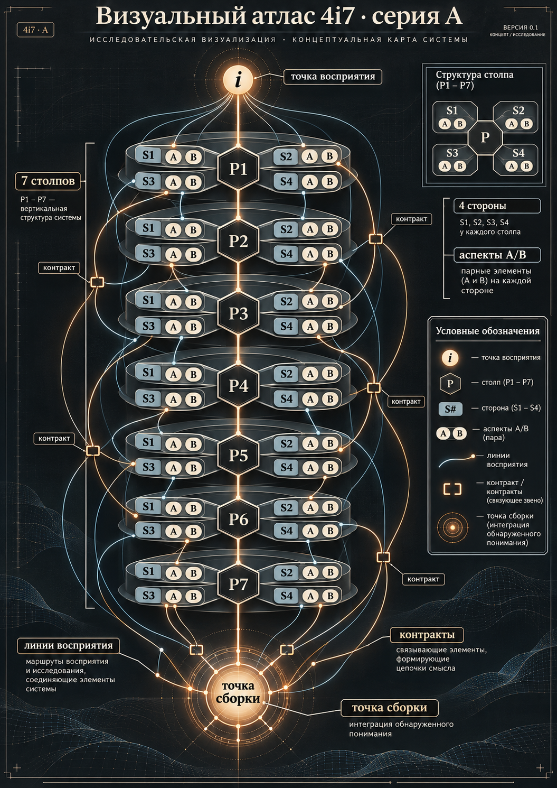

[Оригинал PNG](images/A1.png). 7 столпов, по 4 стороны A/B. Мелкие подписи требуют проверки.

### A2.png: Спираль внимания

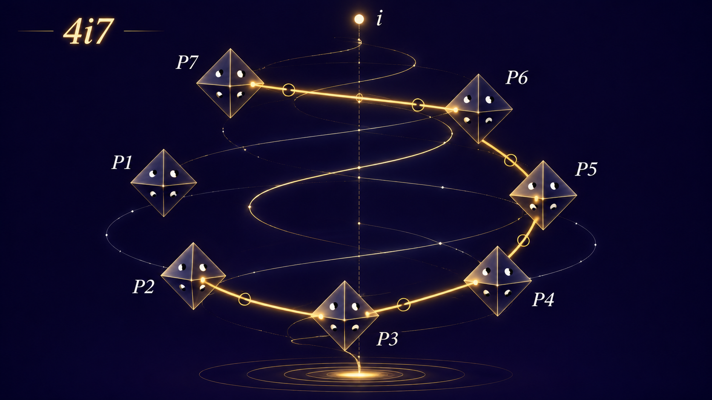

[Оригинал PNG](images/A2.png). Путь художественный, не алгоритм.

### A3.png: Архитектурные столпы

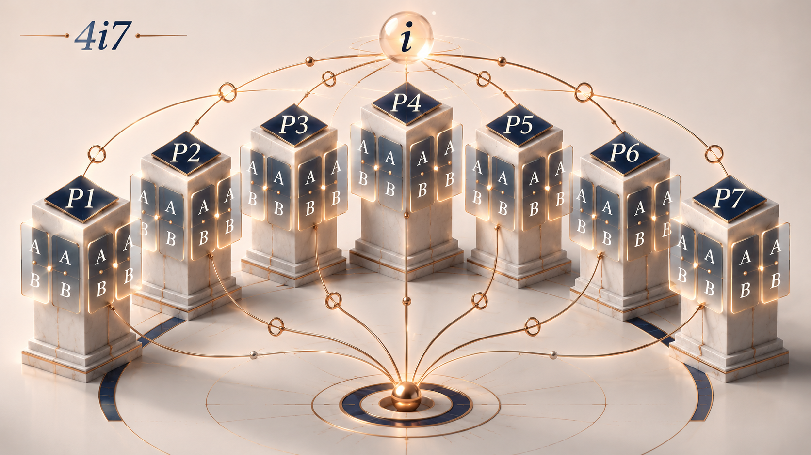

[Оригинал PNG](images/A3.png). Высоты не означают иерархию.

### A4.png: Созвездия

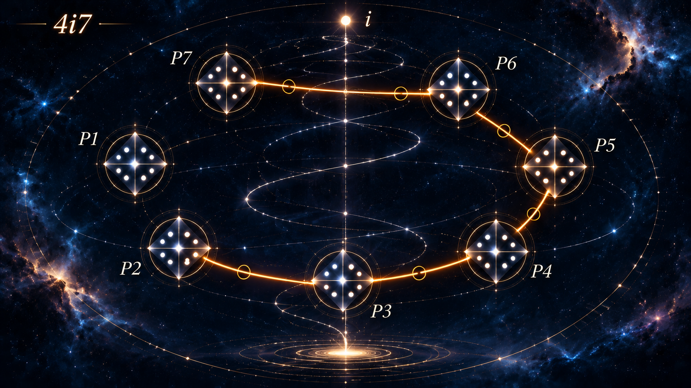

[Оригинал PNG](images/A4.png). Художественная карта связей.

### A4b.png: Созвездия, вариант 2

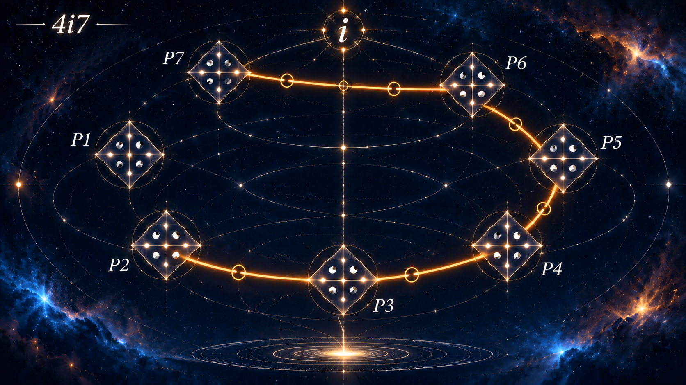

[Оригинал PNG](images/A4b.png). Вариация, не самостоятельное направление.

### A4c.png: Созвездия, вариант 3

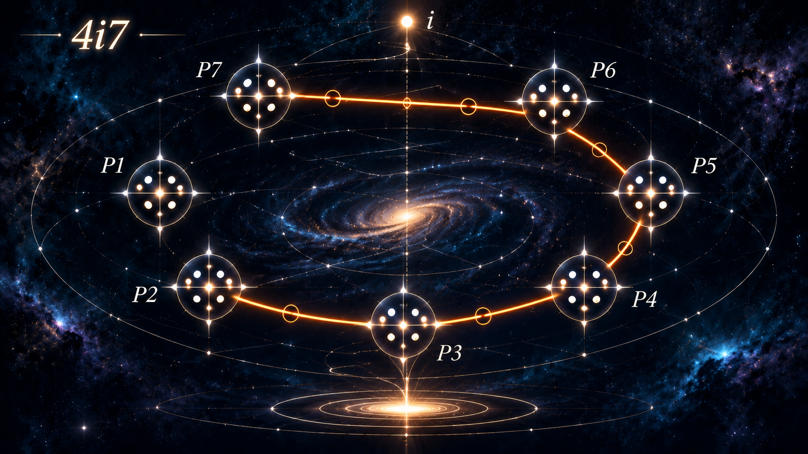

[Оригинал PNG](images/A4c.png). Вариация. Дубликат A4d исключён.

### A5.png: Маршрут метро

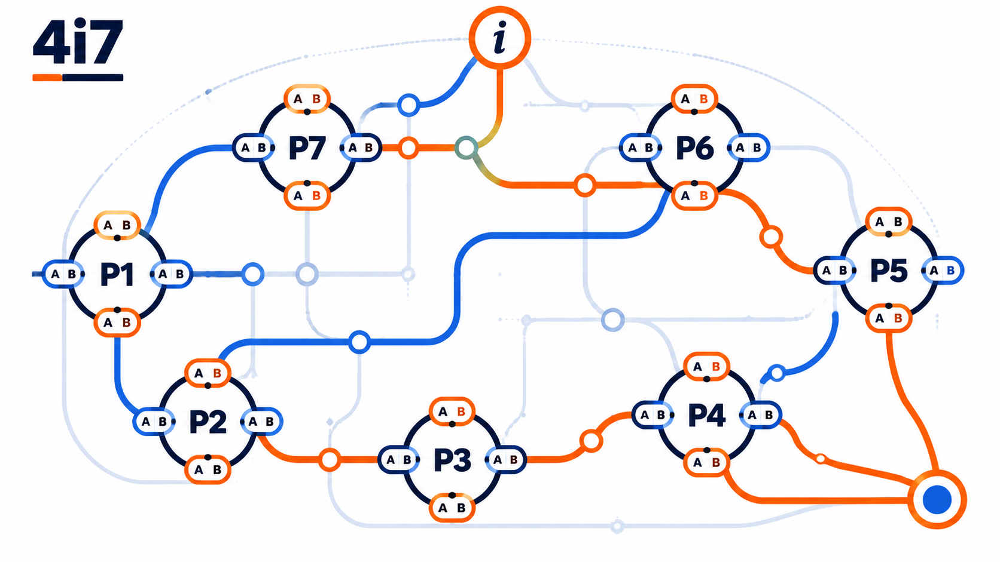

[Оригинал PNG](images/A5.png). 7 станций, по 4 порта A/B.

### B1_landscape.png: Ландшафт понимания

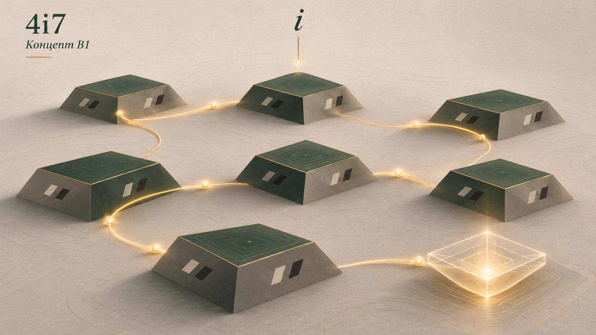

[Оригинал PNG](images/B1_landscape.png). Перспектива скрывает задние грани.

### B2_topographic.png: Топографическая карта

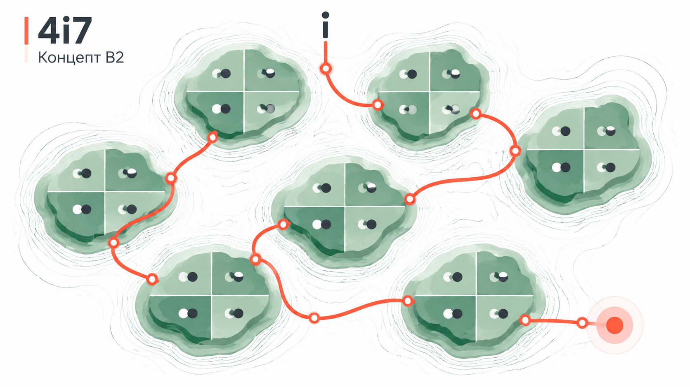

[Оригинал PNG](images/B2_topographic.png). Наиболее буквальный вариант серии B; счёт проверять перед формальным применением.

### B2_topographic_alt2.png: Топография, вариант 2

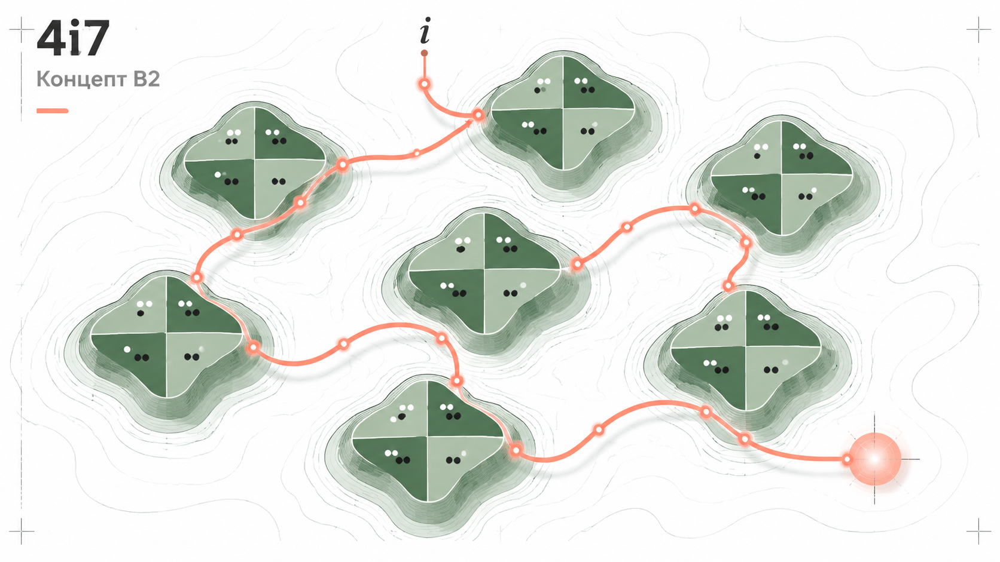

[Оригинал PNG](images/B2_topographic_alt2.png). Есть лишние метки в секторах.

### B2_topographic_alt3.png: Топография, вариант 3

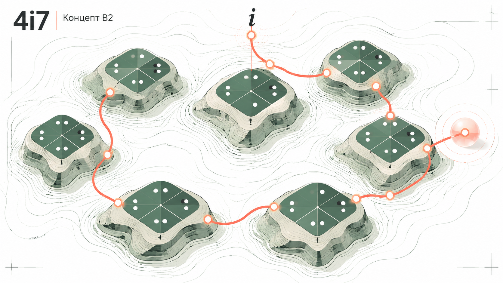

[Оригинал PNG](images/B2_topographic_alt3.png). Часть меток и секторов непоследовательна.

### B2_topographic_alt4.png: Топография, вариант 4

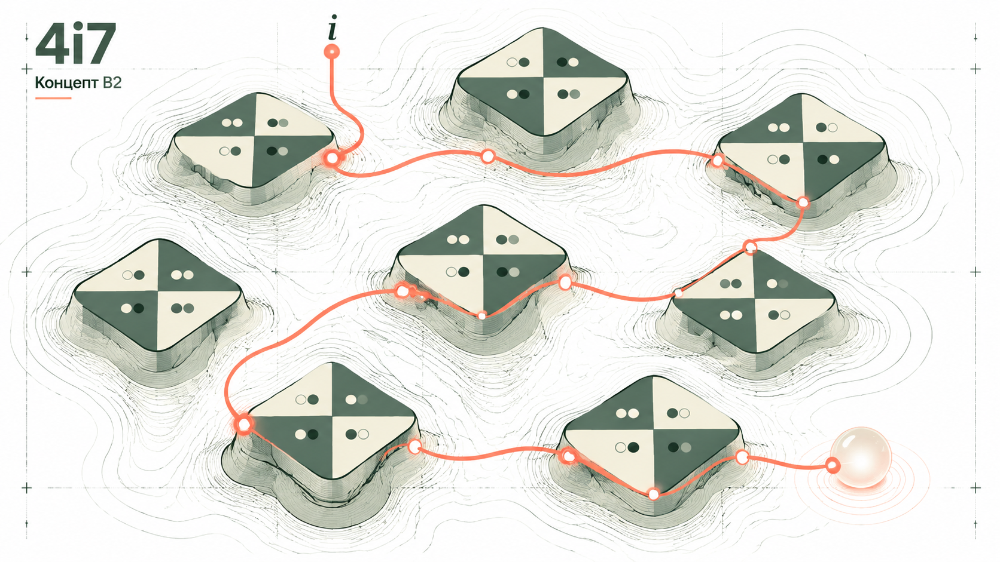

[Оригинал PNG](images/B2_topographic_alt4.png). Парная логика иллюстративна.

### B3_prism.png: Оптическая призма

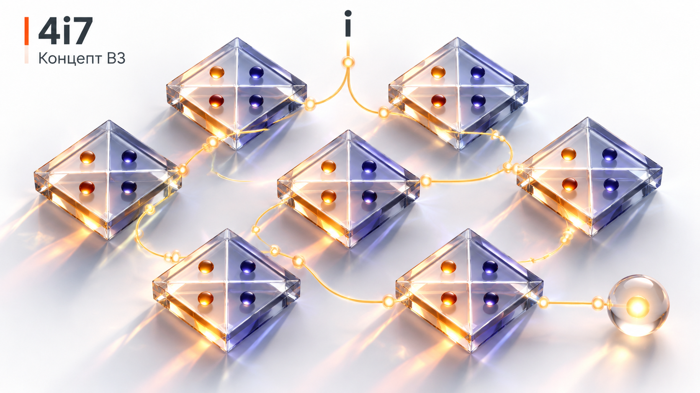

[Оригинал PNG](images/B3_prism.png). Четыре видимые метки вместо восьми. Не точная матрица.

### B4_kinetic.png: Кинетическая скульптура

[Оригинал PNG](images/B4_kinetic.png). Двойственность показана разделённым двухцветным знаком.

### B5_tree.png: Древо смыслов

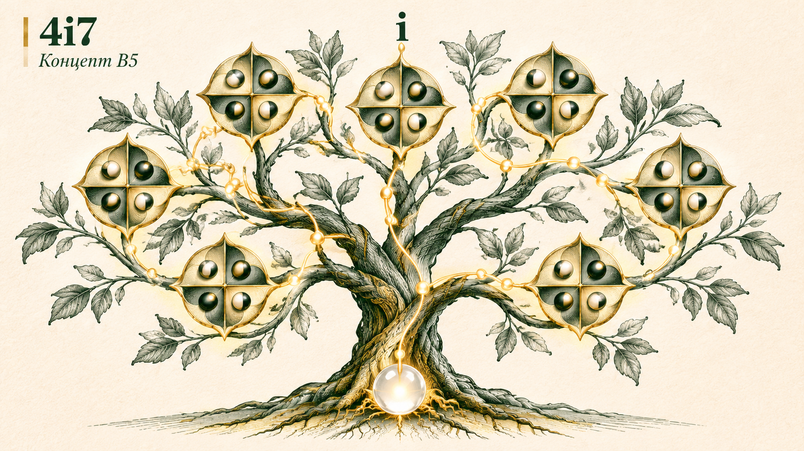

[Оригинал PNG](images/B5_tree.png). Пары местами объединены в двухцветные сферы.

## Проверка и дальнейшая работа

PNG сохранены без переработки; A4d исключён как точный дубликат A4c. A6 (тушь) в эту поставку не входит: готовность не подтверждена. Неодинаковые детали парных маркеров и мелкие подписи делают часть схем концептуальными. Для формальной документации следует собрать проверенную векторную схему после утверждения значений и связей. Не назначать цвета/позиции каноном по эстетическому впечатлению. Все выводы выше исследовательские, код и фундамент этим атласом не изменяются.
