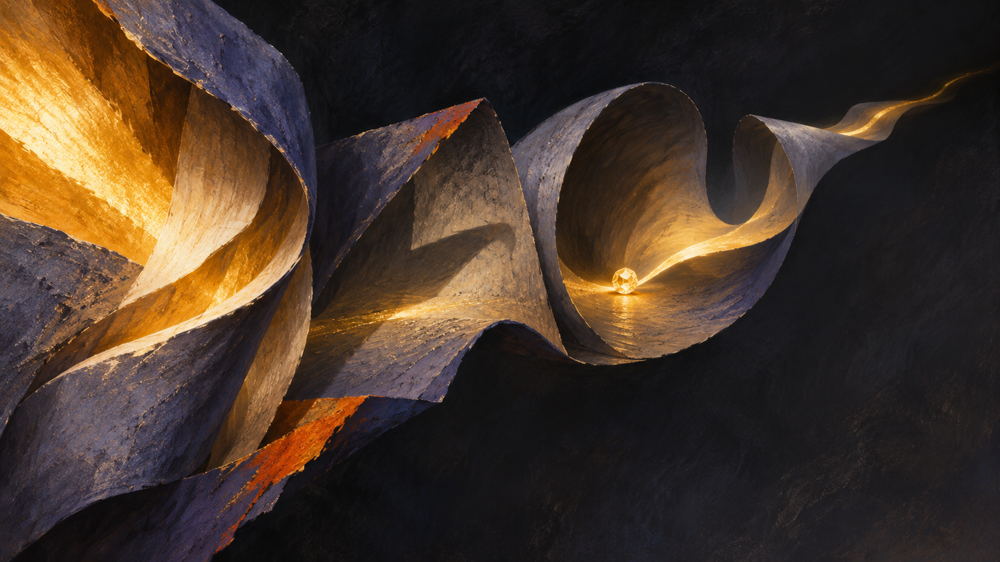
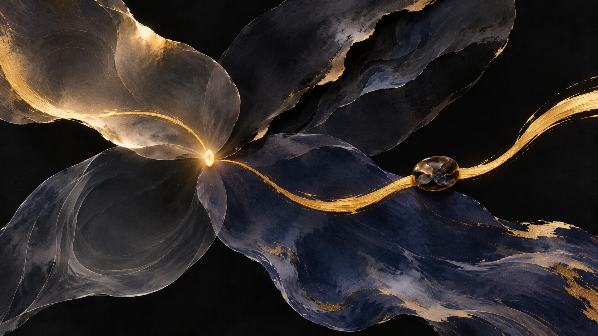
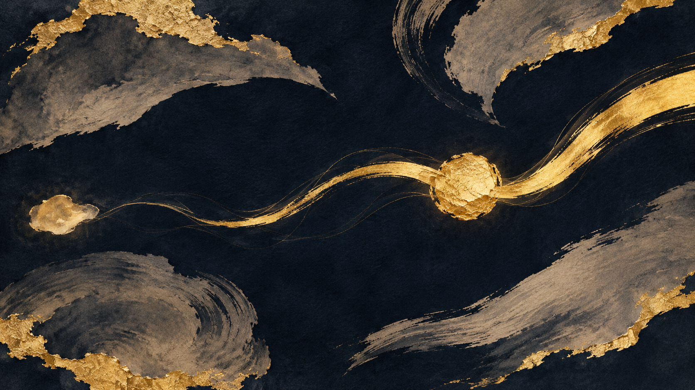

# Первый столп «Идея»: пять визуальных ориентиров

Статус: художественные гипотезы для обсуждения, не каноническая схема.

14 ноября 2026 автор одобрил все пять изображений, выделив первое: «самый первый лучше всего», «эта золотая капелька просто восхитительна».

Контекст: [обсуждение первого столпа и суперконтракта](https://github.com/i4w7w4a/4i7_psys/issues/12), [фиксация и скольжение](https://github.com/i4w7w4a/4i7_psys/issues/12#issuecomment-6876277084). Визуальные формы не назначают окончательные значения сторон, не заменяют определения ноды и контракта.

## 1. Складки пути — фаворит автора

## 2. Слушающие слои

## 3. Узел в слушающей форме

## 4. След смысла

## 5. Узел и продолжение

