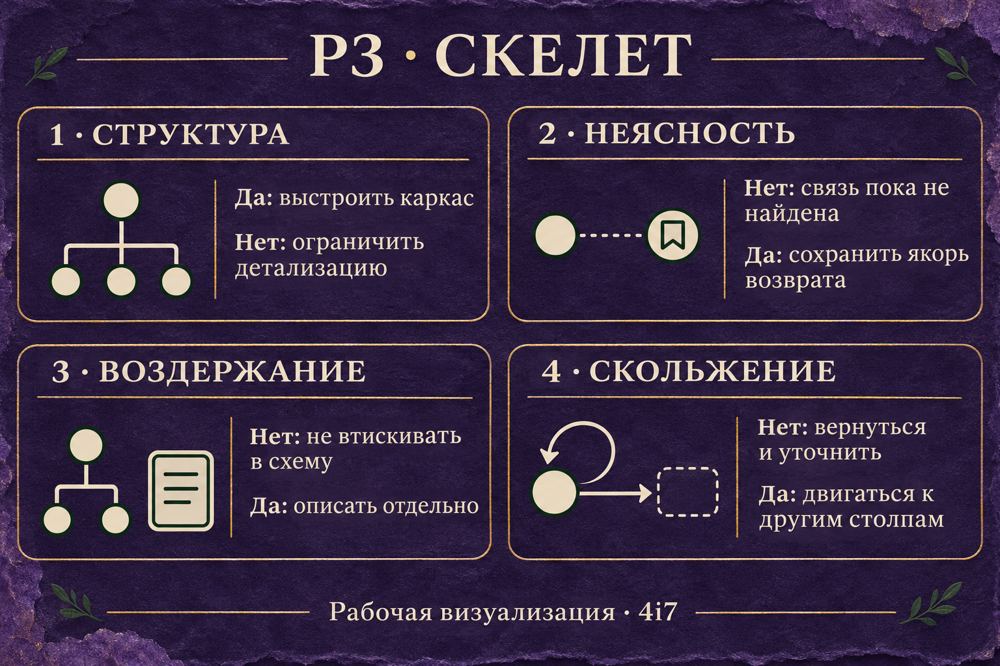
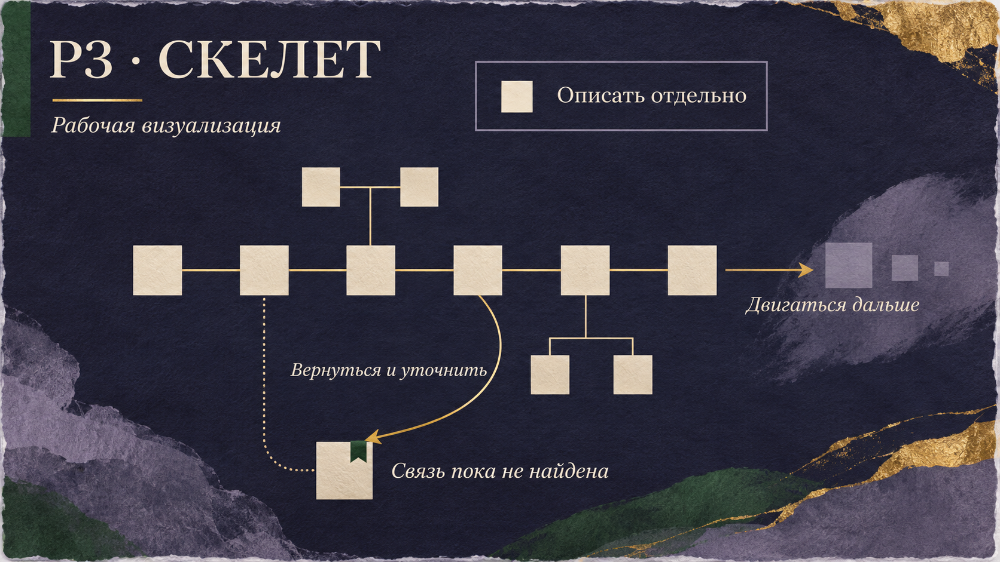
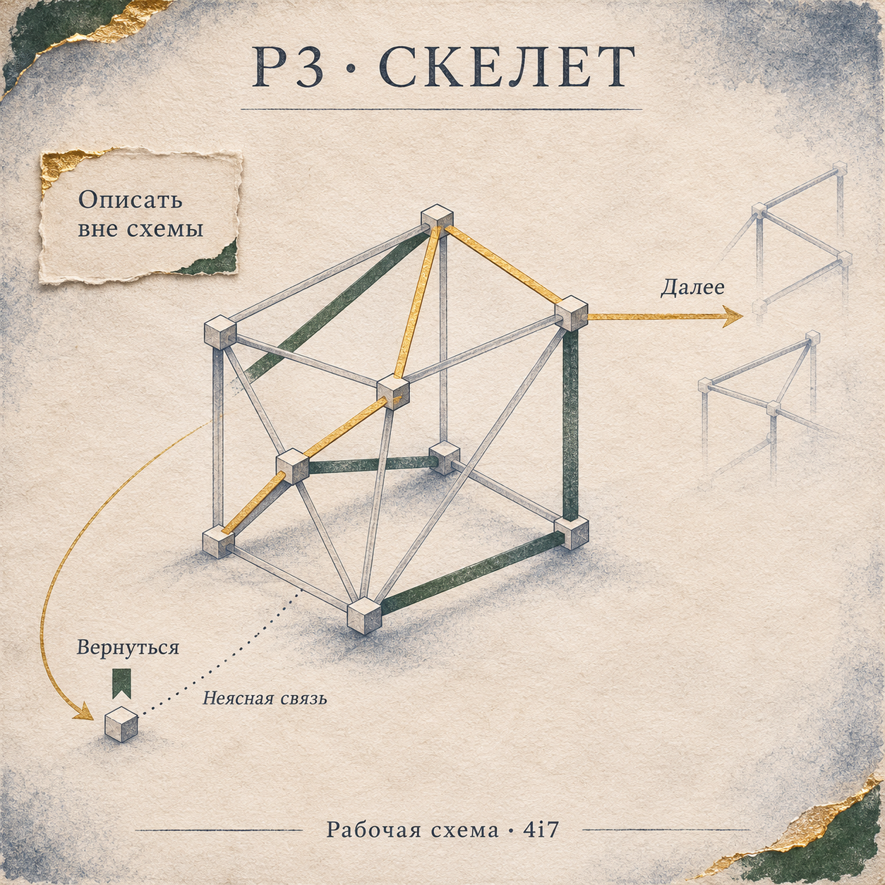

# P3 — Скелет: три схемы

14 ноября 2026. Рабочие визуализации текущего авторского описания; не изменение канона. P3 — Скелет, P2 — Голос.

1. Четыре направления и их аспекты. «Структура» и «Неясность» — описательные заголовки, не новые названия сторон.
2. Путь по каркасу: неясность с якорем возврата, отдельное описание нескелетного, движение внутрь и далее.
3. Объёмный скелет: схема связей и золотой маршрут; количество узлов иллюстративно.

P3/4.нет — возврат внутрь к неясности с более полным пониманием. P3/4.да — движение дальше, к другим столпам и содержательным структурам. Возврат не гарантирует разрешения неясности. Вне скелетной формы не означает вне всей системы.

## 1

## 2

## 3

Контекст: [issue #12](https://github.com/i4w7w4a/4i7_psys/issues/12), [draft PR #14](https://github.com/i4w7w4a/4i7_psys/pull/14).
